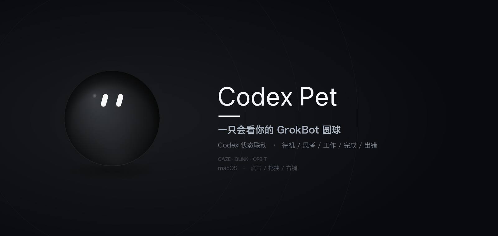
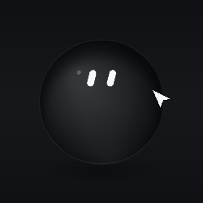
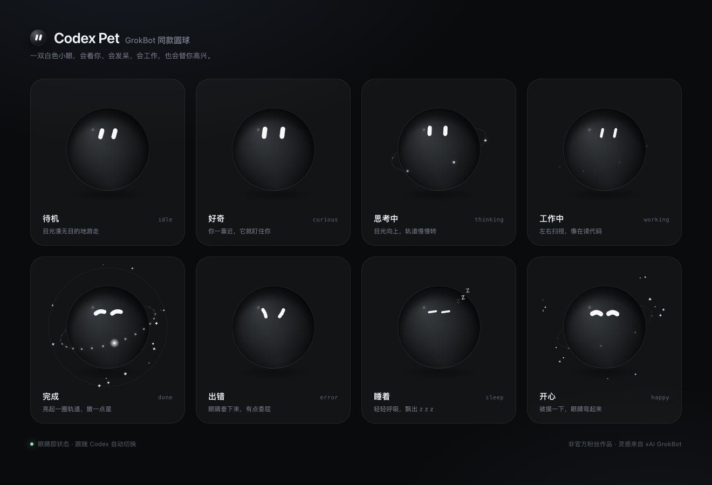
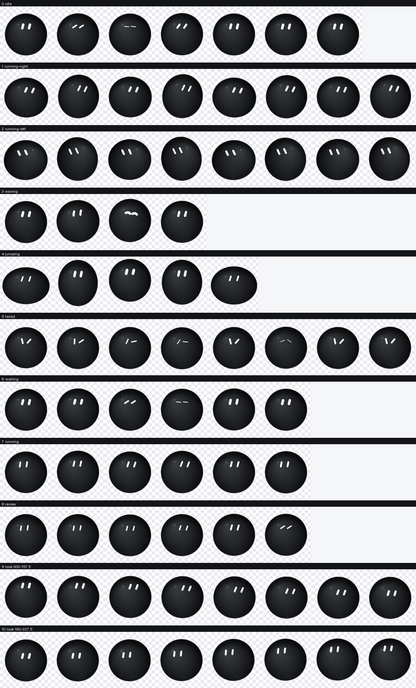

# Codex Pet

> 给 Codex 做的桌宠：一颗黑亮的圆球，两颗白色小眼。
> 按官方那颗黑色圆球的观感重画：两颗实心小白条、一颗更小的球 —— 会看你、会眨眼、会发呆，也会替你高兴。
>
> 现在有两种形态：**macOS 桌面挂件**，以及已经导入 Codex 的 **v2 内置宠物**。

<p align="center">
  
</p>

<p align="center">
  
</p>

## 下载

- **macOS 桌面挂件**：见 Releases 里的 `CodexPet-macOS-arm64.zip`（Apple Silicon，首次打开需右键 → 打开）。
- **Codex v2 宠物**：见 Releases 里的 `GrokBot-CodexPet.zip`，解压到 `~/.codex/pets/grokbot` 即可。

全部下载：[Releases](../../releases/latest)

## 它长什么样



- **待机**：目光慢悠悠地游走，偶尔眨眼、偶尔扫视一下
- **好奇**：鼠标靠近时眼睛会放大，盯住你
- **思考中**：目光向上飘，球外亮起一圈细轨道
- **工作中**：眼睛微微眯起，跟着 Codex 的节奏左右扫视
- **完成**：眼睛弯成两道小弧，撒星星，轨道转一圈
- **出错**：眼睛垂下来，安静地委屈一会儿
- **睡着**：眼睛变成两条横线，飘出 z z z
- **开心**：点一下它，就会弯起眼睛蹦一下

眼睛是实时画出来的：跟随鼠标、弹簧视线、微扫视、随机眨眼、球面透视压缩、闭眼时旋转成横线。
不是 GIF，也不是贴图。

## 快速开始

macOS（已在 macOS 27 / Apple Silicon 上验证）。

**方式一：下载 Release（推荐）**

下载 `CodexPet-macOS-arm64.zip`，解压后双击 `Codex Pet.app`。
第一次如果被 Gatekeeper 拦住，右键 → 打开。启动后 Dock 不显示图标，菜单栏会出现一个圆球小图标。

**方式二：从源码运行**

```bash
cd codex-pet
npm install
npm start
```

启动后，桌宠默认出现在主屏右下角，并自动开始读取 Codex 的活动。

## Codex 内置宠物（v2）

同一个圆球也烘焙成了 Codex 的 v2 宠物，随仓库提供：

```text
~/.codex/pets/grokbot/
├── pet.json
└── spritesheet.webp
```

- 8×11 图集，1536×2288，单格 192×208，透明背景。
- 9 组标准动作：待机 / 向右 / 向左 / 招手 / 跳 / 失败 / 等待 / 工作 / 审视。
- 外加 16 个顺时针视线方向（0°–337.5°），眼睛会跟着光标转。
- `spriteVersionNumber: 2`，lossless WebP，已用 `hatch-pet` 的官方 validator 校验通过。

从 Release 下载 `GrokBot-CodexPet.zip` 后：

```bash
mkdir -p ~/.codex/pets/grokbot
unzip GrokBot-CodexPet.zip -d ~/.codex/pets/grokbot
```

也可以直接用仓库里的脚本：`bash scripts/install-codex-pet.sh`。

打开 Codex 的宠物选择器（平时选 boba / anon 的那个列表），选择 **GrokBot**。如果列表里暂时没有，退出并重新打开一次 Codex（它会扫描 `~/.codex/pets`）。



> 桌面挂件和 Codex 内置宠物是两套独立的运行时，共用同一颗球的视觉；上面的 `.app` 仍然可用。

## 交互

| 操作 | 效果 |
| --- | --- |
| 按住拖动 | 挪到桌面任意位置，退出后记住 |
| 单击 | 摸一下：弯眼、蹦一下、撒星星 |
| 右键 | 表情、大小、置顶、回到右下角、退出 |
| 菜单栏图标 | 同一套菜单 + 自动跟随开关 + 表情预览 |

大小有三档：小 / 标准 / 大。始终置顶、自动跟随 Codex 都可以在菜单里关掉。

## 和 Codex 联动（零配置）

启动后只读地 tail `~/.codex/sessions/` 下最新的 rollout 文件，把事件翻译成表情：

| Codex 事件 | 桌宠 |
| --- | --- |
| `task_started` / `reasoning` | 思考中 |
| `CommandExecution` / `FileChange` / `McpToolCall` / `Extension` | 工作中 |
| `task_complete` | 完成，约 7 秒后回待机 |
| `turn_aborted` / `error` | 出错，约 7 秒后回待机 |
| 45 秒没有新事件 | 回待机 |

细节：

- **不写任何 Codex 文件**，不改 `~/.codex/config.toml`，纯只读。
- 自动跳过 `guardian_review` / `subagent` 产生的 rollout 文件，内部审查不会让桌宠乱动。
- Codex 没在跑时，桌宠就自己待机；不会影响 Codex 的任何行为。
- 思考 / 工作切换做了 9 秒粘滞，避免工具调用之间表情抖动。

## 手动控制 / 接自己的 Agent

本地 HTTP API 只监听 `127.0.0.1:47821`：

```bash
curl 'http://127.0.0.1:47821/state?name=thinking'
curl 'http://127.0.0.1:47821/state?name=working&ttl=12000'
curl 'http://127.0.0.1:47821/state?name=done&ttl=5000'
curl 'http://127.0.0.1:47821/poke'
curl 'http://127.0.0.1:47821/ping'
```

或者用自带的小 CLI：

```bash
node bin/codex-pet.js thinking
node bin/codex-pet.js poke
node bin/codex-pet.js ping
```

可选：Codex 的 `notify` 钩子（一般不需要）

Codex 目前只支持一个 `notify` 程序；如果 `~/.codex/config.toml` 里已经有配置，**不要直接覆盖**。
自动跟随已经覆盖了日常使用场景。确实需要显式推送时：

```toml
notify = ["/usr/bin/env", "node", "/绝对路径/codex-pet/bin/codex-pet-notify.js"]
```

## 自定义

- **大小 / 置顶 / 跟随**：菜单栏图标里改。
- **眼睛比例**：`src/orb/orb.js` 里的 `BASE_POSE`（`len` 长度、`wid` 宽度、`spread` 间距、`eyeY` 高度）。
- **球体光泽**：`src/orb/orb.js` 的 `drawSphere()`（高光、边缘光、底部反射）。
- **状态表情**：`src/orb/orb.js` 的 `targetPose()` 和 `gaze` 部分；`STATES` 里注册新状态。
- **动作时序**：眨眼间隔、扫视速度在 `updateBlink()` / `updateGaze()`。
- **预览全部表情**：`npm run snapshot` 重新生成 `snapshots/`，或者直接打开 `src/gallery.html`。

## 技术实现

- Electron 无边框透明窗口（`type: panel`、不抢焦点、跨 Space 悬浮），Canvas 2D 程序化绘制。
- 眼睛是实心圆头白条：一条 stroke 画完，没有描边/镂空；眨眼时宽度压扁并旋转 82°，自然变成一条横线。
- 桌面挂件的标准球体直径 154px（窗口 230px）；眼睛约 21px 长、8px 宽。Codex 宠物单格 192×208，球体约 156px。
- 视线是弹簧系统，叠加微扫视与无鼠标时的随机游走；靠近球体边缘时按球面透视压缩。
- 轨道点是真正按前后深度分层绘制的：后半圈在球体后面，前半圈在球体前面，并在球体外侧裁掉交叠部分。
- 状态机读取 rollout 的增量字节流（断行对齐、单行 JSON 容错），并用 mtime 找到最新会话文件。
- Codex 宠物图集：Canvas 逐帧绘制到 192×208 透明格，2x 超采样后缩到 1536×2288，再无损编码为 WebP；16 向视线由眼睛位移 + 球体倾斜共同表现。

无网络请求、无遥测、无第三方运行时依赖（Electron 除外）。

## 目录

```
codex-pet/
├── pet-grokbot/            # 可直接放进 ~/.codex/pets 的 v2 宠物包
├── src/
│   ├── main.js              # 透明窗口、托盘、拖拽、状态机、快照
│   ├── preload.js           # 受控 IPC 桥
│   ├── codex-watch.js       # ~/.codex/sessions 增量监听
│   ├── gallery.html/.js     # 表情预览页
│   └── orb/
│       ├── orb.js           # 圆球与眼睛的全部绘制/动画
│       ├── pet.html
│       ├── pet.js
│       ├── atlas.html       # 烘焙 Codex 宠物图集的页面
│       └── atlas.js         # 9 组动作 + 16 向视线的帧编排
├── bin/
│   ├── codex-pet.js         # 本地控制 CLI
│   └── codex-pet-notify.js  # 可选的 Codex notify 适配器
├── assets/                  # 托盘 / 应用图标
├── snapshots/               # 预览图与动图
└── scripts/
    ├── make-assets.py       # 重新生成图标
    └── test-watcher.js      # 事件映射测试
```

## 常见问题

**启动后没看到它？**
看菜单栏的圆球图标，点「回到右下角」。它始终置顶；如果当前全屏应用盖住了一切，它会尽量悬浮在普通窗口之上。

**第一次打开提示“无法验证开发者”？**
右键 `Codex Pet.app` → 打开；或终端 `npm start`。

**为什么没有跟 Codex 联动？**
确认 `~/.codex/sessions/` 有新的 rollout 文件写入，并且 Codex 是正在工作的主会话（不是 guardian review）。菜单里确认「自动跟随 Codex」是勾选状态。

**端口 47821 被占用？**
桌宠会照常运行，只是外部控制 API 不可用。可以用 `CODEX_PET_PORT=另一个端口 npm start` 换端口。

**怎么退出？**
菜单栏圆球 → 退出 Codex Pet。

**开机自启？**
系统设置 → 通用 → 登录项，把 `Codex Pet.app` 加进去即可。

## Credits

非官方粉丝作品。圆球与“白色小眼”的视觉来自 xAI Grok / Grok Bot 的经典形象，本项目与 xAI 无关联，仅作个人桌面陪伴用途。
代码以 MIT 协议开源，见 [LICENSE](LICENSE)。
